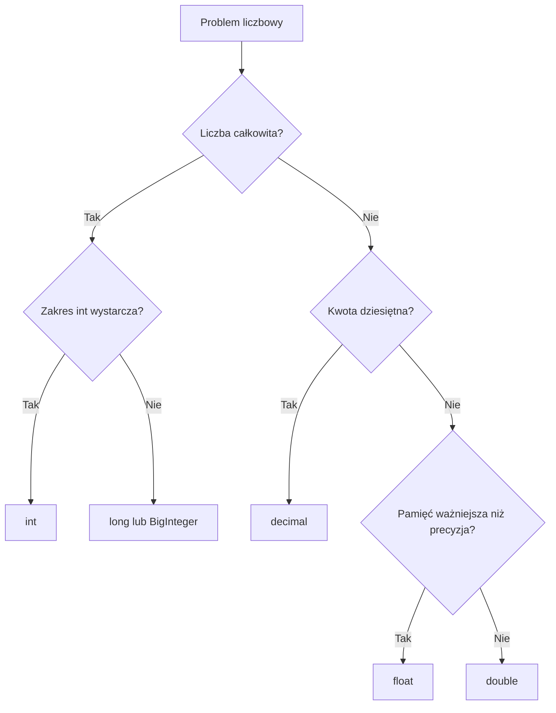

# 01. Typy całkowite i zmiennoprzecinkowe

## Liczby całkowite

Typy całkowite przechowują liczby bez części ułamkowej. W typowych programach najczęściej używamy `int`, który ma 32 bity i zakres od `-2_147_483_648` do `2_147_483_647`. `long` ma 64 bity i wybieramy go, gdy zakres `int` jest za mały. `byte` jest dobry dla wartości od `0` do `255`, na przykład składowych koloru lub danych bajtowych.

```csharp
int liczbaStudentow = 120;
long liczbaOperacji = 5_000_000_000L;
byte poziom = 255;
```

Typ nie określa tylko wyglądu wartości. Określa również zakres, rozmiar, dozwolone konwersje i zachowanie przepełnienia. Dla zwykłych liczników i indeksów wybierz `int`; nie używaj `long` bez potrzeby.

## `float`, `double` i `decimal`

Typy zmiennoprzecinkowe przechowują liczby rzeczywiste w reprezentacji przybliżonej. `float` zajmuje 4 bajty i ma około 6-9 cyfr znaczących, `double` 8 bajtów i około 15-17 cyfr. `decimal` zajmuje 16 bajtów, ma 28-29 cyfr precyzji dziesiętnej i jest właściwy dla kwot finansowych.

| Typ | Typowe użycie | Cechy |
| --- | --- | --- |
| `float` | grafika, duże tablice pomiarów | mniej pamięci, mniejsza precyzja |
| `double` | geometria, symulacje, pomiary | domyślny typ literału ułamkowego, szybkie obliczenia |
| `decimal` | pieniądze, ceny, podatki | precyzja dziesiętna, większy koszt obliczeń |

```csharp
float temperatura = 21.5f;
double odleglosc = 12.75;
decimal cena = 19.99m;
```

Sufiksy `f` i `m` są ważne: bez sufiksu `19.99` jest typu `double`, a `19.99m` typu `decimal`. Nie mieszaj bezpośrednio `decimal` z `float` lub `double`; wybierz jawne rzutowanie, jeśli naprawdę jest potrzebne.

## Reprezentacja i dokładność

Liczba całkowita jest przechowywana dokładnie, o ile mieści się w zakresie typu. Liczby `float` i `double` używają reprezentacji binarnej z częścią znaczącą i wykładnikiem. Niektóre liczby dziesiętne, na przykład `0.1`, nie mają skończonej reprezentacji binarnej.

```csharp
double a = 0.1;
double b = 0.2;
Console.WriteLine(a + b == 0.3); // nie należy zakładać, że wynik będzie true

decimal c = 0.1m;
decimal d = 0.2m;
Console.WriteLine(c + d == 0.3m); // true dla tych wartości dziesiętnych
```

Dla `double` porównuj wartości z tolerancją, gdy wynik jest obliczeniem przybliżonym. Dla pieniędzy używaj `decimal` i ustal zasady zaokrąglania.

## Oś liczbowa: gęstość wartości i epsilon komputerowy

Typy całkowite rozmieszczają wartości równomiernie: między kolejnymi liczbami zawsze jest odstęp `1`. Wszystkie wartości, które mieszczą się w zakresie typu, są dokładne. Typy bez znaku (`byte`, `ushort`, `uint`, `ulong`) zaczynają się od zera, więc nie mają ujemnej części osi. Na krańcach nie ma kolejnej wartości tego samego typu: w kontekście `checked` przepełnienie zgłasza `OverflowException`, a w kontekście `unchecked` wartość całkowita zawija się na drugi koniec zakresu.

Dla `float` i `double` oś liczbowa nie jest równomierna. W pobliżu zera występują bardzo małe liczby podnormalne (subnormalne), a dla większych wartości odstępy między kolejnymi liczbami rosną. W przedziale `[2^e, 2^(e+1))` odstęp dla liczb normalnych wynosi:

- `float`: `2^(e - 23)`, ponieważ ma 24 bity precyzji (23 bity zapisanej części ułamkowej i ukrytą jedynkę),
- `double`: `2^(e - 52)`, ponieważ ma 53 bity precyzji (52 bity zapisanej części ułamkowej i ukrytą jedynkę).

Na przykład w przedziale `[1, 2)` kolejne wartości typu `float` dzieli `2^-23`, a typu `double` `2^-52`. W przedziale zaczynającym się od `2^10` odstęp jest `2^10` razy większy. Po stronie ujemnej odstępy są analogiczne. Zera `+0` i `-0` mają osobne reprezentacje, ale porównują się jako równe.

### Epsilon komputerowy

W tym materiale przez epsilon komputerowy dla typu rzeczywistego rozumiemy odstęp od `1` do następnej większej liczby, którą można zapisać w tym typie:

```text
epsilon przy 1 = następna reprezentowalna wartość po 1 - 1
```

W C# można znaleźć tę wartość przez `MathF.BitIncrement(1f)` albo `Math.BitIncrement(1d)`. Nie należy mylić jej z `float.Epsilon` i `double.Epsilon`. Te stałe oznaczają najmniejszą dodatnią wartość podnormalną, czyli pierwszy krok od zera, a nie odstęp w pobliżu `1`.

| Typ | Pierwsza dodatnia wartość od zera | Odstęp nad `1` | Odstęp pod `1` | Największa skończona wartość |
| --- | ---: | ---: | ---: | ---: |
| `float` | `2^-149` ≈ `1,40129846e-45` | `2^-23` ≈ `1,19209290e-7` | `2^-24` ≈ `5,96046448e-8` | ≈ `3,40282347e38` |
| `double` | `2^-1074` ≈ `4,94065646e-324` | `2^-52` ≈ `2,22044605e-16` | `2^-53` ≈ `1,11022302e-16` | ≈ `1,79769313e308` |
| `decimal` | `1e-28` | `1e-28` w najbliższym otoczeniu `1` | `1e-28` w najbliższym otoczeniu `1` | `79 228 162 514 264 337 593 543 950 335` |

Wartość `float.Epsilon` lub `double.Epsilon` opisuje zatem odległość od zera. W części normalnej `float` i `double` zachowują mniej więcej stałą precyzję względną, ale ich precyzja bezwzględna zależy od położenia na osi. Granica między liczbami podnormalnymi a normalnymi to odpowiednio `2^-126` dla `float` i `2^-1022` dla `double`; poniżej niej odstęp jest stały aż do zera.

### Cecha i mantysa

Liczby `float` i `double` są zapisane trochę jak liczby w notacji naukowej. Na przykład `3500` można zapisać jako `3,5 × 10^3`: `3,5` opisuje cyfry liczby, a `3` mówi, ile razy przesunąć przecinek. Komputer używa podobnego pomysłu, ale w systemie dwójkowym:

```text
znak × mantysa × 2^wykładnik
```

Mantysa przechowuje cyfry liczby, więc decyduje o jej precyzji. Cecha (wykładnik) określa skalę, czyli przesunięcie przecinka binarnego: większa cecha pozwala zapisać większe liczby, ale odstęp między sąsiednimi wartościami też staje się większy. Znak mówi, czy liczba jest dodatnia, czy ujemna.

W zwykłych (`normalnych`) liczbach pierwsza cyfra binarna mantysy jest zawsze `1`, więc komputer nie musi jej zapisywać — można ją sobie dopowiedzieć. Dlatego `float` ma 24 bity precyzji, a `double` 53. `double` może więc rozróżniać więcej cyfr, a oba typy nadal mogą zapisywać zarówno bardzo małe, jak i bardzo duże wartości dzięki wykładnikowi.

Przy samym zerze specjalny zapis pozwala przechować jeszcze mniejsze liczby, ale z mniejszą precyzją. Specjalne wartości cechy oznaczają też nieskończoności i `NaN` (wynik niebędący liczbą), a nie zwykłe liczby skończone.

### Krańce dziedziny

Przy zbliżaniu się do `float.MaxValue` lub `double.MaxValue` odstępy są już bardzo duże. Następna reprezentowalna wartość po największej skończonej wartości to `PositiveInfinity`; po analogicznym przejściu poniżej `float.MinValue` lub `double.MinValue` otrzymujemy `NegativeInfinity`. Przepełnienie arytmetyki zmiennoprzecinkowej daje nieskończoność, a nie `OverflowException`. `float.MinValue` i `double.MinValue` oznaczają najbardziej ujemne wartości skończone, a nie najmniejsze dodatnie wartości — te ostatnie opisują `float.Epsilon` i `double.Epsilon`.

`decimal` działa inaczej. Nie jest binarnym typem IEEE 754 i nie ma binarnej cechy ani mantysy. Przechowuje znak, 96-bitową liczbę całkowitą oraz skalę dziesiętną od `0` do `28`:

```text
wartość decimal = (-1)^znak × liczba_całkowita / 10^skala
```

Dzięki temu wartości takie jak `0,1m`, `0,2m` i `19,99m` są reprezentowane dokładnie, o ile mieszczą się w opisanym formacie. `1m` ma w najbliższym otoczeniu odstęp `1e-28`, a najmniejsza dodatnia wartość różna od zera również wynosi `1e-28`. Dla większych liczb maksymalna skala musi się zmniejszać, więc odstępy rosną; tuż przy `decimal.MaxValue` wynoszą `1`. `decimal` nie ma `Infinity` ani `NaN`, a operacja przekraczająca jego zakres zgłasza `OverflowException`. Nadal jest to typ skończonej precyzji — na przykład `1m / 3m` jest zaokrąglane po dostępnych 28–29 cyfrach dziesiętnych.



Źródło: [diagram-dobor-typu.mmd](diagram-dobor-typu.mmd).

## Przykład: pomiar i cena

Projekt [Kod/Liczby/Program.cs](Kod/Liczby/Program.cs) pokazuje wszystkie trzy rodziny typów i wypisuje rozmiary przez `sizeof` dla typów prostych.

## Zadania z rozwiązaniami

1. Wybierz typ dla liczby mieszkańców kraju, ceny produktu, temperatury z czujnika i liczby bajtów pliku.
2. Sprawdź wynik `5 / 2`, `5 / 2.0` i `5m / 2m` oraz wyjaśnij różnicę.
3. Pokaż w programie, że `double` może dać wynik z błędem zaokrąglenia, a `decimal` lepiej reprezentuje `0.1m + 0.2m`.
4. Oblicz odstęp między `1` a następną wartością dla `float` i `double`. Porównaj go z `float.Epsilon` oraz `double.Epsilon`.
5. Sprawdź odstępy przy `0`, `1` i `float.MaxValue`. Wyjaśnij, dlaczego nie są jednakowe.

Rozwiązanie: mieszkańcy zwykle `int` lub `long`, cena `decimal`, temperatura `double`, a rozmiar pojedynczego bajtu `byte` lub większy typ całkowity. `5 / 2` wykonuje dzielenie całkowite i daje `2`; obecność `double` lub `decimal` zmienia rodzaj dzielenia.

## Laboratorium

```powershell
dotnet build
dotnet run
```

Ustaw punkt przerwania przed każdym obliczeniem i obserwuj typ oraz wartość. Sprawdź skrajne wartości `int`, wynik dzielenia całkowitego i różnicę między `double` a `decimal`. Program pokazuje także sąsiadujące wartości przy `0` i `1`, odstęp przy największych wartościach oraz przejście od `MaxValue` do nieskończoności.

## Źródła

- [Integral numeric types](https://learn.microsoft.com/dotnet/csharp/language-reference/builtin-types/integral-numeric-types),
- [Floating-point numeric types](https://learn.microsoft.com/dotnet/csharp/language-reference/builtin-types/floating-point-numeric-types),
- [System.Math.BitIncrement](https://learn.microsoft.com/dotnet/api/system.math.bitincrement),
- [The `decimal` type](https://learn.microsoft.com/dotnet/standard/base-types/decimal),
- [Arithmetic operators](https://learn.microsoft.com/dotnet/csharp/language-reference/operators/arithmetic-operators).
