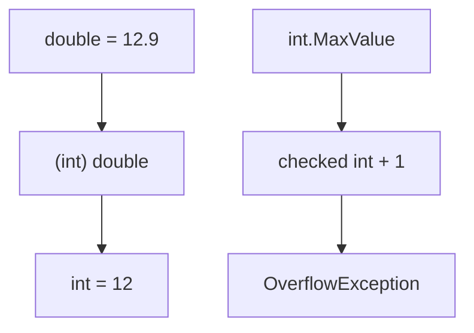

# 03. Konwersje typów i rzutowania

## Po co konwertujemy?

Konwersja zmienia reprezentację wartości na inny typ. Może być niejawna, gdy kompilator zna bezpieczną drogę, albo jawna, gdy programista potwierdza zgodę na możliwą utratę danych.

```csharp
int liczba = 10;
long wieksza = liczba;
double przyblizenie = liczba;
int calkowita = (int)12.9;
```

Konwersja `double` lub `decimal` do typu całkowitego obcina część ułamkową, a nie zaokrągla jej. Przy konwersjach zawężających może wystąpić utrata zakresu albo `OverflowException` w kontekście `checked`.

## Tekst na liczbę: `Parse` i `TryParse`

`int.Parse` zgłasza wyjątek dla niepoprawnego tekstu. `int.TryParse` zwraca `false`, dzięki czemu program może obsłużyć dane bez wyjątku:

```csharp
if (int.TryParse(Console.ReadLine(), out int wynik))
{
    Console.WriteLine(wynik + 1);
}
else
{
    Console.WriteLine("Niepoprawna liczba.");
}
```

## Przykład 1: bezpieczne rzutowanie

Projekt [Kod/Rzutowanie/Program.cs](Kod/Rzutowanie/Program.cs) pokazuje obcięcie części ułamkowej oraz kontrolę przepełnienia.



Źródło: [diagram-konwersje.mmd](diagram-konwersje.mmd).

## Przykład 2: konwersja tekstu i typ docelowy

Projekt [Kod/Wczytywanie/Program.cs](Kod/Wczytywanie/Program.cs) wczytuje `decimal` przez `TryParse`, a następnie oblicza podatek.

```csharp
if (!decimal.TryParse(Console.ReadLine(), out decimal netto))
{
    Console.WriteLine("Podaj poprawną kwotę.");
    return;
}

decimal brutto = netto * 1.23m;
```

## `checked` i `unchecked`

`checked` wymusza wykrycie przepełnienia operacji całkowitej:

```csharp
try
{
    int wynik = checked(int.MaxValue + 1);
}
catch (OverflowException)
{
    Console.WriteLine("Wynik nie mieści się w int.");
}
```

## Zadania z rozwiązaniami

1. Wczytaj `double` i wypisz jego część całkowitą jako `int`.
2. Wczytaj dwie liczby tekstowe przez `TryParse` i oblicz ich średnią jako `double`.
3. Zademonstruj różnicę między rzutowaniem `double` na `int` a zaokrągleniem przez `Math.Round`.

### Rozwiązania

```csharp
// 1. Najpierw sprawdź, czy tekst jest liczbą i czy mieści się w zakresie int.
if (double.TryParse(Console.ReadLine(), out double wartosc) &&
    double.IsFinite(wartosc) &&
    wartosc >= int.MinValue &&
    wartosc <= int.MaxValue)
{
    int czescCalkowita = (int)wartosc; // obcięcie części ułamkowej w stronę zera
    Console.WriteLine(czescCalkowita);
}
else
{
    Console.WriteLine("Niepoprawna liczba albo wartość poza zakresem int.");
}

// 2. TryParse sprawdza każde wejście; rzutowanie na double przed dzieleniem
//    zapobiega dzieleniu całkowitemu.
if (int.TryParse(Console.ReadLine(), out int pierwsza) &&
    int.TryParse(Console.ReadLine(), out int druga))
{
    double srednia = ((double)pierwsza + druga) / 2;
    Console.WriteLine($"Średnia: {srednia}");
}
else
{
    Console.WriteLine("Podaj dwie poprawne liczby całkowite.");
}

// 3. Rzutowanie obcina, a Math.Round zaokrągla.
double wartoscDoPorownania = 12.8;
int obciecie = (int)wartoscDoPorownania; // 12
int zaokraglenie = (int)Math.Round(wartoscDoPorownania); // 13
Console.WriteLine($"Obcięcie: {obciecie}, zaokrąglenie: {zaokraglenie}");
```

Domyślne `Math.Round` zaokrągla połówki do najbliższej liczby parzystej; jeśli wymagane jest zaokrąglanie połówek w górę, wybierz jawnie `MidpointRounding.AwayFromZero`.

## Laboratorium

```powershell
dotnet build
dotnet run
```

Sprawdź tekst, liczbę ułamkową, wartość poza zakresem oraz przepełnienie. Ustaw punkt przerwania przed i po konwersji.

## Źródła

- [Built-in numeric conversions](https://learn.microsoft.com/dotnet/csharp/language-reference/builtin-types/numeric-conversions),
- [Cast expressions](https://learn.microsoft.com/dotnet/csharp/language-reference/operators/type-testing-and-cast#cast-expression),
- [checked and unchecked](https://learn.microsoft.com/dotnet/csharp/language-reference/statements/checked-and-unchecked),
- [Parse and TryParse](https://learn.microsoft.com/dotnet/standard/base-types/parsing-numeric).
