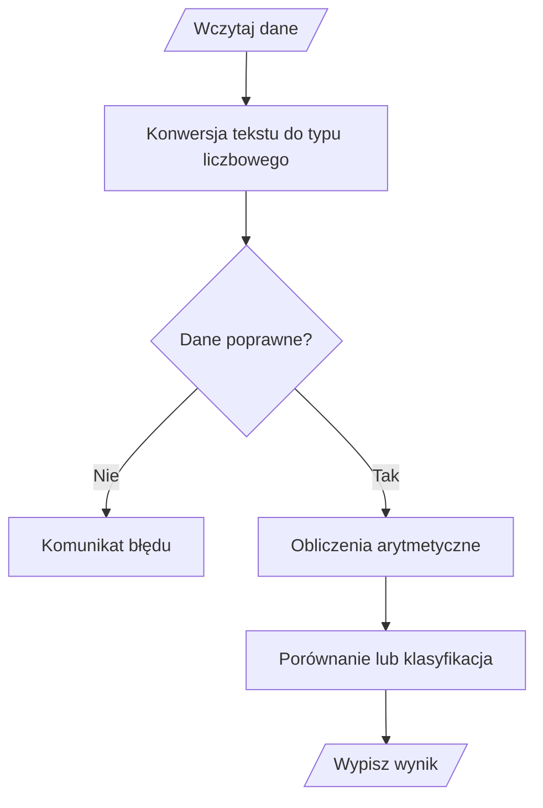

# 07. Programy wykorzystujące typy i operatory

Poniższe projekty łączą wszystkie pojęcia modułu. Każdy jest osobną aplikacją konsolową `net9.0` i może być prezentowany na wykładzie albo wykonany krokowo na laboratorium.

## Program 1: BMI

Projekt [Kod/Bmi/Program.cs](Kod/Bmi/Program.cs) używa `double` do pomiaru masy i wzrostu, operatorów arytmetycznych oraz relacyjnych do klasyfikacji wyniku.

Wzór: $BMI = \frac{masa}{wzrost^2}$.

## Program 2: faktura

Projekt [Kod/Faktura/Program.cs](Kod/Faktura/Program.cs) używa `decimal` dla kwot, `const` dla stawki VAT i nawiasowania, aby najpierw zsumować pozycje, a potem naliczyć podatek.

```csharp
const decimal Vat = 0.23m;
decimal brutto = (cenaNetto * ilosc) * (1 + Vat);
```

## Program 3: konwerter sekund

Projekt [Kod/Czas/Program.cs](Kod/Czas/Program.cs) używa dzielenia całkowitego i operatora `%` do rozbicia liczby sekund na godziny, minuty i sekundy. Pokazuje także, dlaczego kolejność operacji ma znaczenie.

## Program 4: lokata

Projekt [Kod/Lokata/Program.cs](Kod/Lokata/Program.cs) używa `decimal`, stałej stawki podatku i operatorów arytmetycznych do obliczenia odsetek netto. Warunek relacyjny sprawdza, czy kwota spełnia minimum.

## Program 5: geometria trójkąta

Projekt [Kod/Geometria/Program.cs](Kod/Geometria/Program.cs) używa `double`, konwersji tekstu przez `TryParse`, operatorów logicznych do walidacji boków i wzoru Herona do obliczenia pola.



Źródło: [diagram-programy.mmd](diagram-programy.mmd).

## Zestawienie

| Program | Typy | Najważniejsze operatory |
| --- | --- | --- |
| BMI | `double` | `/`, `*`, `>`, `<=` |
| Faktura | `decimal`, `const` | `*`, `+`, nawiasy |
| Czas | `int` | `/`, `%` |
| Lokata | `decimal`, `const` | `*`, `-`, `>=` |
| Geometria | `double` | `+`, `-`, `*`, `/`, `&&` |

## Zadania dla studentów

1. Do BMI dodaj klasyfikację z granicami i komunikat dla danych niedodatnich.
2. Do faktury dodaj rabat `10%`, stosowany przed VAT-em tylko dla sumy netto powyżej `500`.
3. Do konwertera sekund dodaj konwersję na dni.
4. Do lokaty dodaj sprawdzenie, czy okres lokaty jest dodatnią liczbą całkowitą.
5. Do geometrii dodaj obliczenie obwodu i sprawdzanie, czy trójkąt jest równoboczny.

### Rozwiązania i wyjaśnienia

1. Najpierw odrzuć niedodatnią masę lub wzrost, a potem oblicz BMI i przypisz kategorię. Przykładowe granice są orientacyjne dla dorosłych:

   ```csharp
   const double Niedowaga = 18.5;
   const double PrawidlowaMasa = 25.0;
   const double Nadwaga = 30.0;

   if (masa <= 0 || wzrost <= 0)
   {
       Console.WriteLine("Masa i wzrost muszą być dodatnie.");
   }
   else
   {
       double bmi = masa / (wzrost * wzrost);
       string kategoria = bmi < Niedowaga ? "niedowaga"
           : bmi < PrawidlowaMasa ? "prawidłowa masa"
           : bmi < Nadwaga ? "nadwaga"
           : "otyłość";
       Console.WriteLine($"BMI: {bmi:F1}, kategoria: {kategoria}");
   }
   ```

2. Rabat oblicz od sumy netto, jeśli przekracza próg, a VAT nalicz dopiero po rabacie:

   ```csharp
   const decimal ProgRabatu = 500m;
   const decimal Rabat = 0.10m;
   const decimal Vat = 0.23m;

   decimal sumaNetto = cenaNetto * ilosc;
   decimal nettoPoRabacie = sumaNetto > ProgRabatu
       ? sumaNetto * (1 - Rabat)
       : sumaNetto;
   decimal brutto = nettoPoRabacie * (1 + Vat);
   ```

3. Dla nieujemnej liczby sekund:

   ```csharp
   int dni = sekundy / 86_400;
   int pozostaleSekundy = sekundy % 86_400;
   int godziny = pozostaleSekundy / 3_600;
   pozostaleSekundy %= 3_600;
   int minuty = pozostaleSekundy / 60;
   int resztaSekund = pozostaleSekundy % 60;
   ```

4. Parsowanie musi się powieść, a okres musi być dodatni, zanim użyjesz go w obliczeniach:

   ```csharp
   if (int.TryParse(Console.ReadLine(), out int okres) && okres > 0)
   {
       Console.WriteLine($"Okres: {okres}");
   }
   else
   {
       Console.WriteLine("Podaj dodatnią liczbę całkowitą.");
   }
   ```

5. Po walidacji trójkąta oblicz obwód i sprawdź równość boków:

   ```csharp
   double obwod = a + b + c;
   bool rownoboczny = a == b && b == c;
   Console.WriteLine($"Obwód: {obwod}, równoboczny: {rownoboczny}");
   ```

   Przy bokach wczytywanych jako wyniki obliczeń zmiennoprzecinkowych zamiast dokładnego `==` zastosuj porównanie z tolerancją.

## Laboratorium i debugowanie

Każdy projekt uruchamiaj w jego katalogu:

```powershell
dotnet build
dotnet run
```

Dla każdego programu przygotuj przypadek typowy, graniczny i błędny. W debugerze zatrzymaj wykonanie po konwersji wejścia, po obliczeniu wartości pośredniej i przed wypisaniem wyniku.

## Źródła

- [Numeric types](https://learn.microsoft.com/dotnet/csharp/language-reference/builtin-types/numeric-types),
- [Numeric conversions](https://learn.microsoft.com/dotnet/csharp/language-reference/builtin-types/numeric-conversions),
- [The `const` keyword](https://learn.microsoft.com/dotnet/csharp/language-reference/keywords/const),
- [Operators and expressions](https://learn.microsoft.com/dotnet/csharp/language-reference/operators/),
- [Math.Sqrt](https://learn.microsoft.com/dotnet/api/system.math.sqrt).
