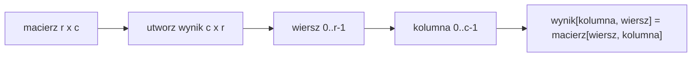

# 02. Inicjalizacja i tablice wielowymiarowe

## Trzy różne kształty danych

W C# zapis typu określa liczbę wymiarów:

```csharp
int[] wektor = new int[5];
int[,] macierz = new int[3, 4];
int[,,] kostka = new int[2, 3, 4];
int[][] tablicaPostrzepiona = new int[3][];
```

`int[,]` to jedna tablica o dwóch wymiarach. Każdy element ma adres `macierz[wiersz, kolumna]`. `int[][]` to tablica, której elementami są inne tablice; poszczególne wiersze mogą mieć różną długość i muszą być utworzone osobno.

## Inicjalizacja

Tablicę można najpierw utworzyć z rozmiarem, a potem wypełnić, albo zainicjalizować od razu:

```csharp
int[,] dane =
{
    { 8, 3, 5 },
    { 2, 9, 4 }
};

int[][] wiersze =
{
    new[] { 1, 2 },
    new[] { 3, 4, 5 },
    new[] { 6 }
};
```

Nie trzeba używać `new[]` w nowej składni kolekcji, ale jawne zapisy pokazują, że w tablicy postrzępionej każdy wiersz jest odrębną tablicą. Elementy pominięte podczas tworzenia mają wartości domyślne: `0` dla `int`, `0.0` dla `double` i `null` dla typów referencyjnych.

## Rozmiary i bezpieczne pętle

Dla macierzy nie używamy `Length` jako granicy obu pętli. `Length` jest liczbą wszystkich elementów, a `GetLength(0)` oznacza liczbę wierszy i `GetLength(1)` liczbę kolumn.

```csharp
for (int wiersz = 0; wiersz < dane.GetLength(0); wiersz++)
{
    for (int kolumna = 0; kolumna < dane.GetLength(1); kolumna++)
    {
        Console.Write($"{dane[wiersz, kolumna]} ");
    }
    Console.WriteLine();
}
```

Dla `int[][]` wewnętrzna granica zależy od konkretnego wiersza:

```csharp
for (int wiersz = 0; wiersz < wiersze.Length; wiersz++)
{
    for (int kolumna = 0; kolumna < wiersze[wiersz].Length; kolumna++)
    {
        Console.Write($"{wiersze[wiersz][kolumna]} ");
    }
}
```

## Przykład: suma i transpozycja

Transpozycja macierzy zamienia wiersze z kolumnami. Dla macierzy o rozmiarze `r x c` wynik ma rozmiar `c x r`, więc nie można bezwarunkowo zapisywać do tablicy o tym samym rozmiarze.



Źródło: [diagram-inicjalizacja-macierze.mmd](diagram-inicjalizacja-macierze.mmd).

## Projekt demonstracyjny

Projekt [Kod/Macierze/Program.cs](Kod/Macierze/Program.cs) pokazuje tablicę z wartościami domyślnymi, macierz `[,]`, tablicę postrzępioną, sumy wierszy i transpozycję. W debuggerze obserwuj różnicę między `Length`, `GetLength(0)` i `GetLength(1)`.

## Zadania do samodzielnego rozwiązania

1. Utwórz macierz `4 x 4` i wypełnij ją liczbami od `1` do `16` wierszami.
2. Oblicz sumę głównej przekątnej macierzy kwadratowej.
3. Zbuduj tablicę postrzępioną przechowującą oceny studentów, gdy każdy student ma inną liczbę ocen. Oblicz średnią każdego wiersza.
4. Napisz metodę, która sprawdza, czy macierz jest symetryczna względem głównej przekątnej.

### Rozwiązania

1. Wypełniaj macierz wierszami; wzór daje kolejne liczby od `1` do `16`:

   ```csharp
   int[,] macierz = new int[4, 4];
   for (int wiersz = 0; wiersz < macierz.GetLength(0); wiersz++)
   {
       for (int kolumna = 0; kolumna < macierz.GetLength(1); kolumna++)
       {
           macierz[wiersz, kolumna] =
               wiersz * macierz.GetLength(1) + kolumna + 1;
       }
   }
   ```

2. Przekątna główna zawiera elementy `[i, i]`. Suma używa `long`, aby ograniczyć ryzyko przepełnienia:

   ```csharp
   static long SumaPrzekatnej(int[,] macierz)
   {
       if (macierz.GetLength(0) != macierz.GetLength(1))
       {
           throw new ArgumentException("Macierz musi być kwadratowa.", nameof(macierz));
       }

       long suma = 0;
       for (int indeks = 0; indeks < macierz.GetLength(0); indeks++)
       {
           suma += macierz[indeks, indeks];
       }
       return suma;
   }
   ```

3. Każdy student ma własną tablicę ocen, dlatego wiersze mogą mieć różne długości:

   ```csharp
   int[][] oceny =
   {
       new[] { 5, 4, 5 },
       new[] { 3, 4 },
       Array.Empty<int>()
   };

   for (int student = 0; student < oceny.Length; student++)
   {
       if (oceny[student].Length == 0)
       {
           Console.WriteLine($"Student {student}: brak ocen");
           continue;
       }

       double srednia = 0;
       foreach (int ocena in oceny[student])
       {
           srednia += ocena;
       }
       srednia /= oceny[student].Length;
       Console.WriteLine($"Student {student}: {srednia:F2}");
   }
   ```

4. Macierz prostokątna nie może być symetryczna. Dla macierzy kwadratowej wystarczy sprawdzać elementy nad przekątną:

   ```csharp
   static bool CzySymetryczna(int[,] macierz)
   {
       int wiersze = macierz.GetLength(0);
       int kolumny = macierz.GetLength(1);
       if (wiersze != kolumny)
       {
           return false;
       }

       for (int wiersz = 0; wiersz < wiersze; wiersz++)
       {
           for (int kolumna = wiersz + 1; kolumna < kolumny; kolumna++)
           {
               if (macierz[wiersz, kolumna] != macierz[kolumna, wiersz])
               {
                   return false;
               }
           }
       }
       return true;
   }
   ```

Symetryczność wymaga równości `macierz[i, j]` i `macierz[j, i]` dla każdej pary indeksów. Sprawdzenie tylko połowy macierzy wystarcza, bo relacja jest symetryczna.

## Laboratorium

1. Uruchom przykład dla macierzy prostokątnej `2 x 3`.
2. Zmień jedną wartość i sprawdź wpływ na sumę wiersza oraz transpozycję.
3. Doprowadź celowo do błędu przez użycie `macierz.Length` w pętli kolumn i wyjaśnij wyjątek.
4. Ustaw punkt przerwania na przypisaniu `transpozycja[kolumna, wiersz]`.

```powershell
dotnet build
dotnet run
```

## Źródła

- [Multidimensional arrays](https://learn.microsoft.com/dotnet/csharp/programming-guide/arrays/multidimensional-arrays),
- [Arrays - C# reference](https://learn.microsoft.com/dotnet/csharp/language-reference/builtin-types/arrays),
- [Array.GetLength method](https://learn.microsoft.com/dotnet/api/system.array.getlength).
