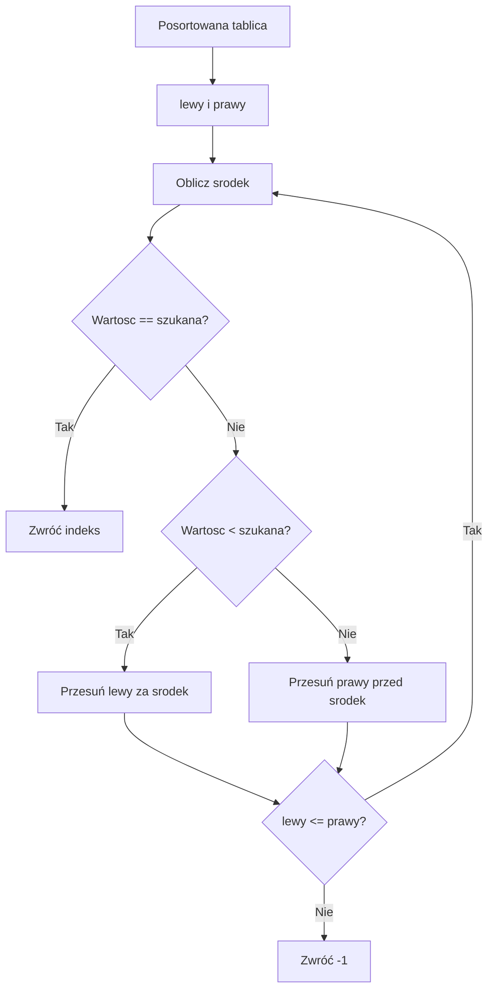

# 03. Wyszukiwanie w tablicach

## Wyszukiwanie liniowe

Wyszukiwanie liniowe sprawdza elementy od początku do końca. Kończy się po znalezieniu wartości albo po sprawdzeniu całej tablicy. Nie wymaga sortowania i działa dla dowolnego typu, dla którego można porównać elementy.

```csharp
static int SzukajLiniowo(int[] liczby, int szukana)
{
    for (int indeks = 0; indeks < liczby.Length; indeks++)
    {
        if (liczby[indeks] == szukana)
        {
            return indeks;
        }
    }
    return -1;
}
```

Jeżeli element jest na początku, koszt może wynieść jedno porównanie. Jeżeli go nie ma albo znajduje się na końcu, potrzebujemy do `n` porównań. Złożoność pesymistyczna to $O(n)$, a pamięć dodatkowa $O(1)$.

## Wyszukiwanie binarne

Wyszukiwanie binarne działa tylko wtedy, gdy tablica jest posortowana zgodnie z tym samym porządkiem, którego używa porównanie. W każdej iteracji wybieramy środek przedziału i odrzucamy połowę elementów:

```csharp
static int SzukajBinarnie(int[] liczby, int szukana)
{
    int lewy = 0;
    int prawy = liczby.Length - 1;

    while (lewy <= prawy)
    {
        int srodek = lewy + (prawy - lewy) / 2;
        if (liczby[srodek] == szukana)
        {
            return srodek;
        }

        if (liczby[srodek] < szukana)
        {
            lewy = srodek + 1;
        }
        else
        {
            prawy = srodek - 1;
        }
    }

    return -1;
}
```

Wzór na środek zapisany jako `lewy + (prawy - lewy) / 2` unika przepełnienia, które może powstać przy `(lewy + prawy) / 2` dla bardzo dużych indeksów. Złożoność wyszukiwania binarnego to $O(\\log n)$.



Źródło: [diagram-wyszukiwanie.mmd](diagram-wyszukiwanie.mmd).

## Wyszukiwanie biblioteczne

C# udostępnia `Array.IndexOf` dla wyszukiwania równościowego oraz `Array.BinarySearch` dla posortowanej tablicy. `Array.BinarySearch` zwraca indeks, gdy element istnieje. Gdy elementu nie ma, zwraca liczbę ujemną, a `~wynik` wskazuje miejsce, w którym można go wstawić.

```csharp
Array.Sort(liczby);
int indeks = Array.BinarySearch(liczby, 17);
if (indeks < 0)
{
    int miejsce = ~indeks;
}
```

Biblioteka jest właściwa w kodzie produkcyjnym, ale implementacja własnej metody jest wartościowa dydaktycznie: pokazuje niezmiennik przedziału i warunek zakończenia.

## Projekt demonstracyjny

Projekt [Kod/Wyszukiwanie/Program.cs](Kod/Wyszukiwanie/Program.cs) porównuje wyszukiwanie liniowe, własne wyszukiwanie binarne i `Array.BinarySearch`. Wypisuje liczbę porównań, dzięki czemu różnica jest widoczna na danych o różnym rozmiarze.

## Zadania do samodzielnego rozwiązania

1. Zmień wyszukiwanie liniowe tak, aby zwracało liczbę wystąpień wartości.
2. Napisz metodę zwracającą pierwszy indeks wartości w posortowanej tablicy, gdy duplikatów jest wiele.
3. Napisz wyszukiwanie binarne dla tablicy uporządkowanej malejąco.
4. Porównaj liczbę porównań dla tablicy 10, 1000 i 1 000 000 elementów.

### Rozwiązania

1. Zlicz wszystkie dopasowania; nie kończ pętli przy pierwszym trafieniu:

   ```csharp
   static int PoliczWystapienia(int[] liczby, int szukana)
   {
       int licznik = 0;
       foreach (int liczba in liczby)
       {
           if (liczba == szukana)
           {
               licznik++;
           }
       }
       return licznik;
   }
   ```

2. Po znalezieniu wartości zapamiętaj indeks i kontynuuj po lewej stronie, aby odnaleźć wcześniejszy duplikat:

   ```csharp
   static int PierwszyIndeks(int[] liczby, int szukana)
   {
       int lewy = 0;
       int prawy = liczby.Length - 1;
       int wynik = -1;

       while (lewy <= prawy)
       {
           int srodek = lewy + (prawy - lewy) / 2;
           if (liczby[srodek] >= szukana)
           {
               if (liczby[srodek] == szukana)
               {
                   wynik = srodek;
               }
               prawy = srodek - 1;
           }
           else
           {
               lewy = srodek + 1;
           }
       }
       return wynik;
   }
   ```

3. Dla porządku malejącego zmień kierunek przesuwania granic:

   ```csharp
   static int SzukajMalejaco(int[] liczby, int szukana)
   {
       int lewy = 0;
       int prawy = liczby.Length - 1;
       while (lewy <= prawy)
       {
           int srodek = lewy + (prawy - lewy) / 2;
           if (liczby[srodek] == szukana)
           {
               return srodek;
           }

           if (liczby[srodek] > szukana)
           {
               lewy = srodek + 1;
           }
           else
           {
               prawy = srodek - 1;
           }
       }
       return -1;
   }
   ```

4. Poniższe metody liczą porównania elementu z szukaną wartością. Binarne wyszukiwanie może wykonać do dwóch takich porównań w jednej iteracji:

   ```csharp
   static int Liniowo(int[] liczby, int szukana, out int porownania)
   {
       porownania = 0;
       for (int indeks = 0; indeks < liczby.Length; indeks++)
       {
           porownania++;
           if (liczby[indeks] == szukana)
           {
               return indeks;
           }
       }
       return -1;
   }

   static int Binarnie(int[] liczby, int szukana, out int porownania)
   {
       int lewy = 0;
       int prawy = liczby.Length - 1;
       porownania = 0;
       while (lewy <= prawy)
       {
           int srodek = lewy + (prawy - lewy) / 2;
           porownania++;
           if (liczby[srodek] == szukana)
           {
               return srodek;
           }

           porownania++;
           if (liczby[srodek] < szukana)
           {
               lewy = srodek + 1;
           }
           else
           {
               prawy = srodek - 1;
           }
       }
       return -1;
   }

   foreach (int n in new[] { 10, 1_000, 1_000_000 })
   {
       int[] dane = Enumerable.Range(0, n).ToArray();
       _ = Liniowo(dane, n, out int porownaniaLiniowe);
       _ = Binarnie(dane, n, out int porownaniaBinarne);
       Console.WriteLine($"n={n}: liniowo {porownaniaLiniowe}, binarnie {porownaniaBinarne}");
   }
   ```

   Dla nieobecnej wartości większej od wszystkich elementów wyszukiwanie liniowe wykona `n` porównań. Binarne wykona około `2 log2(n)` porównań elementu z kluczem (np. około `40` dla miliona elementów). W praktyce trzeba też uwzględnić koszt wcześniejszego sortowania i utrzymywania danych w porządku.

## Laboratorium

1. Uruchom przykład dla elementu na początku, na końcu i nieobecnego.
2. Dodaj duplikaty i obserwuj, który indeks zwracają różne metody.
3. Usuń sortowanie przed wyszukiwaniem binarnym i zapisz, dla jakiego wejścia wynik staje się błędny.
4. W debuggerze obserwuj `lewy`, `prawy` i `srodek`.

```powershell
dotnet build
dotnet run
```

## Źródła

- [Array.IndexOf method](https://learn.microsoft.com/dotnet/api/system.array.indexof),
- [Array.BinarySearch method](https://learn.microsoft.com/dotnet/api/system.array.binarysearch),
- [Binary search algorithm](https://en.wikipedia.org/wiki/Binary_search_algorithm).
