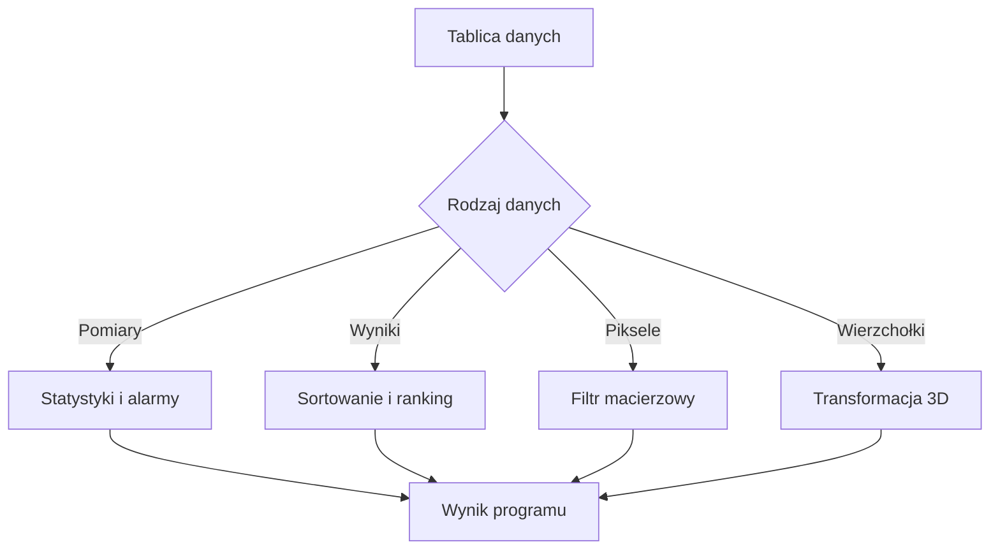

# 06. Programy wykorzystujące tablice

Poniższe cztery projekty są kompletne i niezależne. Każdy może być pokazany na wykładzie, a następnie rozszerzony przez studentów na laboratorium. Wszystkie używają aplikacji konsolowych `net9.0` i pokazują, że tablica jest modelem danych, a nie tylko ćwiczeniem z indeksów.

## Program 1: monitoring temperatury

Projekt [Kod/Monitoring/Program.cs](Kod/Monitoring/Program.cs) przechowuje serię pomiarów temperatury w `double[]`. Oblicza minimum, maksimum, średnią, liczbę alarmów oraz wyszukuje pierwszy pomiar przekraczający limit.

Zastosowanie: telemetria urządzeń IoT, logi czujników i monitoring serwera. W prawdziwym systemie dane przychodziłyby strumieniowo, ale tablica dobrze pokazuje analizę ustalonego okna pomiarowego.

## Program 2: ranking wyników

Projekt [Kod/Ranking/Program.cs](Kod/Ranking/Program.cs) przechowuje identyfikatory studentów i wyniki w dwóch powiązanych tablicach. Sortuje je malejąco przez `Array.Sort(wyniki, identyfikatory)`, a następnie wypisuje podium.

Zastosowanie: ranking wyników, kolejka priorytetów i sortowanie rekordów po kluczu. Wniosek projektowy: równoległe tablice są możliwe, lecz łatwo utracić zgodność indeksów; przy większym programie warto użyć obiektów lub rekordów.

## Program 3: filtr obrazu

Projekt [Kod/Obraz/Program.cs](Kod/Obraz/Program.cs) reprezentuje obraz w skali szarości jako `int[,]`. Nakłada filtr średniej `3 x 3`, pomijając sąsiadów spoza obrazu, oraz wypisuje macierz przed i po filtracji.

Zastosowanie: wstępne przetwarzanie obrazu, wygładzanie pomiarów przestrzennych i macierze map. Program pokazuje, dlaczego wynik trzeba zapisywać do nowej macierzy, a nie zmieniać wejście w trakcie obliczeń.

## Program 4: transformacja modelu 3D

Projekt [Kod/Model3D/Program.cs](Kod/Model3D/Program.cs) przechowuje osiem wierzchołków prostopadłościanu w `Vector3[]`. Tworzy wspólną macierz skalowania, obrotu i przesunięcia, a następnie transformuje każdy wierzchołek.

Zastosowanie: grafika komputerowa, wizualizacja CAD i symulacja położenia obiektu. `Vector3[]` jest naturalnym wyborem dla zbioru punktów, a `Matrix4x4` pozwala zastosować identyczną transformację do całego modelu.



Źródło: [diagram-programy-tablice.mmd](diagram-programy-tablice.mmd).

## Zestawienie

| Program | Struktura | Główna idea | Koszt przykładu |
| --- | --- | --- | ---: |
| Monitoring | `double[]` | jeden przebieg i alarmy | $O(n)$ |
| Ranking | `int[]` + `string[]` | sortowanie powiązanych danych | $O(n \\log n)$ dla `Array.Sort` |
| Obraz | `int[,]` | sąsiedztwo i filtr `3 x 3` | $O(r \\cdot c)$ |
| Model 3D | `Vector3[]` | wspólna macierz transformacji | $O(n)$ |

## Zadania do samodzielnego rozwiązania

1. Do monitoringu dodaj medianę, odchylenie od średniej i alarm, gdy trzy kolejne pomiary przekroczą limit.
2. Do rankingu dodaj remis: przy tych samych punktach sortuj identyfikatory alfabetycznie. Zachowaj zgodność danych.
3. Do obrazu dodaj filtr medianowy i porównaj go z filtrem średniej dla pojedynczego jasnego zakłócenia.
4. Do modelu 3D dodaj obrót wokół osi Y oraz wypisz zakres współrzędnych po transformacji.
5. Przygotuj testy przypadków: puste dane, jeden element, duplikaty, macierz jednowierszowa i punkt w początku układu.

### Rozwiązania

1. Oblicz średnią przed odchyleniem standardowym; kopię sortuj do wyznaczenia mediany, zachowując oryginalną kolejność pomiarów. Alarm zgłoś, gdy licznik przekroczy trzy kolejne pomiary ponad limitem:

   ```csharp
   static void AnalizujPomiary(double[] pomiary, double limit)
   {
       if (pomiary.Length == 0)
       {
           Console.WriteLine("Brak pomiarów.");
           return;
       }

       double srednia = pomiary.Average();
       double[] posortowane = (double[])pomiary.Clone();
       Array.Sort(posortowane);
       int srodek = posortowane.Length / 2;
       double mediana = posortowane.Length % 2 == 0
           ? (posortowane[srodek - 1] + posortowane[srodek]) / 2
           : posortowane[srodek];

       double sumaKwadratowOdchylen = 0;
       foreach (double pomiar in pomiary)
       {
           double odchylenie = pomiar - srednia;
           sumaKwadratowOdchylen += odchylenie * odchylenie;
       }
       double odchylenieStandardowe = Math.Sqrt(sumaKwadratowOdchylen / pomiary.Length);
       Console.WriteLine($"Mediana: {mediana}, odchylenie standardowe: {odchylenieStandardowe}");

       int kolejneAlarmy = 0;
       for (int indeks = 0; indeks < pomiary.Length; indeks++)
       {
           if (pomiary[indeks] > limit)
           {
               kolejneAlarmy++;
               if (kolejneAlarmy == 3)
               {
                   Console.WriteLine($"Alarm: seria zaczyna się przy indeksie {indeks - 2}.");
               }
           }
           else
           {
               kolejneAlarmy = 0;
           }
       }
   }
   ```

   Powyższe odchylenie standardowe traktuje dane jako całą badaną populację i dzieli sumę kwadratów przez `n`. Dla próby statystycznej mianownikiem byłoby `n - 1`.

2. Spakuj wynik i identyfikator w jeden rekord (tu: krotkę), aby nie rozdzielić powiązanych danych. Sortuj po punktach malejąco, a przy remisie po identyfikatorze rosnąco:

   ```csharp
   (string Id, int Punkty)[] ranking =
   {
       ("S-02", 90), ("S-01", 90), ("S-03", 80)
   };

   Array.Sort(ranking, (a, b) =>
   {
       int porownaniePunktow = b.Punkty.CompareTo(a.Punkty);
       return porownaniePunktow != 0
           ? porownaniePunktow
           : StringComparer.Ordinal.Compare(a.Id, b.Id);
   });
   ```

   Wynik to `S-01: 90`, `S-02: 90`, `S-03: 80`. Przenoszenie rekordu jako całości zachowuje zgodność identyfikatora z punktami.

3. Użyj metody `FiltrMedianowy` z [tematu o algorytmach macierzowych](../05-algorytmy-macierzowe/README.md#rozwiązania). Dla przykładowego obrazu:

   ```csharp
   int[,] obraz = { { 10, 10, 10 }, { 10, 255, 10 }, { 10, 10, 10 } };
   int[,] wynik = FiltrMedianowy(obraz);
   ```

   Środek po filtrze medianowym ma wartość `10`; filtr średniej da około `37`. Oryginał należy zachować, a wynik zapisać do nowej macierzy.

4. Obrót wokół osi Y zachowuje współrzędną Y i miesza X z Z. Zastosuj jedną macierz do wszystkich punktów, a potem oblicz zakres współrzędnych:

   ```csharp
   Vector3[] wierzcholki =
   {
       new(-1, -1, -1), new(1, -1, -1), new(-1, 1, -1), new(1, 1, -1),
       new(-1, -1, 1), new(1, -1, 1), new(-1, 1, 1), new(1, 1, 1)
   };
   Matrix4x4 transformacja =
       Matrix4x4.CreateScale(2, 1, 1) *
       Matrix4x4.CreateRotationY(MathF.PI / 2) *
       Matrix4x4.CreateTranslation(3, 0, 0);

   Vector3[] przeksztalcone = new Vector3[wierzcholki.Length];
   for (int indeks = 0; indeks < wierzcholki.Length; indeks++)
   {
       przeksztalcone[indeks] = Vector3.Transform(wierzcholki[indeks], transformacja);
   }

   Vector3 minimum = przeksztalcone[0];
   Vector3 maksimum = przeksztalcone[0];
   foreach (Vector3 punkt in przeksztalcone)
   {
       minimum = Vector3.Min(minimum, punkt);
       maksimum = Vector3.Max(maksimum, punkt);
   }
   Console.WriteLine($"Min: {minimum}, max: {maksimum}");
   ```

5. Tabela przedstawia przykładowe przypadki i oczekiwane zachowanie; nazwy metod dopasuj do testowanego projektu:

   | Przypadek | Dane | Oczekiwany wynik |
   | --- | --- | --- |
   | Puste pomiary | `double[] { }` | Brak statystyk; program nie zgłasza wyjątku. |
   | Jeden pomiar | `{ 12 }` | Minimum, maksimum, średnia i mediana `12`; odchylenie standardowe `0`. |
   | Remis w rankingu | `("S-02", 90), ("S-01", 90)` | Oba wyniki pozostają przypisane do identyfikatorów; `S-01` jest pierwszy. |
   | Macierz jednowierszowa | `{{ 10, 20, 30 }}` | Wymiary wyniku filtracji to `1 x 3`; pętle nie wychodzą poza granice. |
   | Punkt w początku układu | `(0, 0, 0)` | Sama rotacja i skalowanie pozostawiają go w `(0, 0, 0)`; przesunięcie dodaje wektor translacji. |

   Przy duplikatach testuj zarówno zachowanie liczby wystąpień, jak i zachowanie wszystkich powiązanych danych. Dla macierzy sprawdzaj rozmiar i wartości, a dla transformacji porównuj współrzędne z tolerancją zmiennoprzecinkową.

## Instrukcja laboratorium

W każdym projekcie:

```powershell
dotnet build
dotnet run
```

Zatrzymuj wykonanie po utworzeniu tablicy, po sortowaniu lub obliczeniu wartości pośredniej oraz przed wypisaniem wyniku. W oknie Locals obserwuj `Length`, indeks bieżącego elementu, rozmiary macierzy i wynik transformacji. Każdy program powinien mieć przypadek typowy, graniczny i błędny.

## Źródła

- [Arrays - C# reference](https://learn.microsoft.com/dotnet/csharp/language-reference/builtin-types/arrays),
- [Array.Sort method](https://learn.microsoft.com/dotnet/api/system.array.sort),
- [Matrix4x4 structure](https://learn.microsoft.com/dotnet/api/system.numerics.matrix4x4),
- [Vector3 structure](https://learn.microsoft.com/dotnet/api/system.numerics.vector3).
